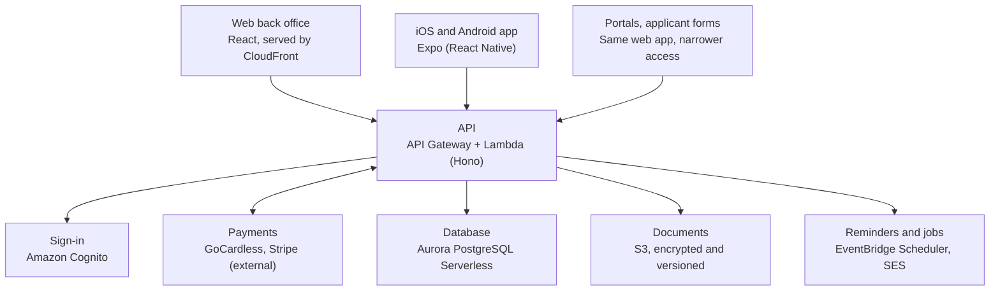

# Lettings Platform — Design Document

12 November 2026 · Hassan

## Summary

This is a multi-agency lettings platform for the UK: each letting agency gets its own account to manage properties, tenancies, compliance, rent, referencing and documents. It ships as a web back office plus an iOS app, with Android later from the same mobile code.

| Decision | Choice | Why |
| --- | --- | --- |
| Customers | Letting agencies and self-managing landlords (multi-company SaaS) | Your own business is the first customer; others sign up later |
| Coverage | England, Wales, Scotland, Northern Ireland | Compliance rules are data per nation, not code per nation |
| Rent | Collected in-app by Direct Debit | Each agency connects its own GoCardless account; the platform never holds client money |
| Hosting | AWS London region, serverless | Near-zero cost when idle; UK data residency |
| Mobile | Expo (React Native) | One codebase for iOS and Android |
| Language | TypeScript everywhere | Shared rules and types across API, web and mobile |

Two things to know up front. The AWS new-account allowance is $100 at sign-up plus up to $100 earned, so $200 rather than $300. And the compliance rules shipped in the code are a starting set that a lettings solicitor should review before you sell to other agencies.

## Users and the multi-agency model

Every record belongs to one agency (an "organisation"), and the database itself refuses to return another agency's rows. This uses PostgreSQL row-level security keyed on `org_id`, so a bug in application code cannot leak data between agencies.

| Role | Signs in to | Can do |
| --- | --- | --- |
| Agency owner | Web, mobile | Everything, plus billing, staff and the GoCardless connection |
| Agency staff | Web, mobile | Properties, tenancies, compliance, rent, referencing, documents |
| Landlord | Web portal, mobile | View own properties, statements, certificates; approve works |
| Tenant | Mobile, web portal | View rent and documents, set up Direct Debit, report repairs |
| Applicant | Web link (no account) | Complete a referencing application and upload evidence |
| Contractor (later) | Web link | See a job, upload a certificate or invoice |

Staff, landlords and tenants all sign in through the same web address and the same mobile app; the role on the account decides what each person sees. Landlord and tenant logins are part of the first release, not a later phase.

### Tenant login and maintenance reporting

1. The agency adds a tenant to a tenancy and the tenant receives an email invitation to set a password.
2. The tenant signs in on the app or web and sees only their own tenancy: rent, documents and repairs.
3. To report an issue they pick a category and urgency, describe it and attach photos from the phone camera.
4. Agency staff triage the report, assign a contractor and set an appointment.
5. Every change of status or message is added to the report's timeline, and the tenant gets a push notification and an email.
6. The landlord sees the report on their own login, with costs, and can approve or decline quoted works.
7. The tenant confirms the repair is done, or reopens it.

Reports marked as an emergency (no heating, leak, electrical danger, security) alert staff immediately, and response times are recorded against each report.

## Modules

| Module | What it holds | Key behaviour |
| --- | --- | --- |
| Portfolio | Landlords, properties, units or rooms | Nation and local council set per property, which drives the compliance rules |
| Tenancies | Tenancy, tenants, guarantors, deposit, rent terms | Tenancy type follows the nation; rent increases logged with notice dates |
| Compliance | Requirements per property, tenancy, landlord and agency | Generated from rules; each has a due date, evidence document and status |
| Rent | Rent schedule, charges, payments, arrears | Charges raised automatically; Direct Debit payments matched by webhook |
| Referencing | Applications, checks, decision | Applicant fills a secure form; staff record each check and the outcome |
| Documents | Files in folders per property, tenancy, landlord | Stored in S3, versioned, linked to compliance items, expiry-aware |
| Maintenance | Repair reports, jobs, contractors | Tenant reports with photos; response times tracked |
| Reminders | Email and push notifications | Certificates due in 60, 30 and 7 days; arrears; missing evidence |
| Audit log | Who did what, when | Every change recorded; needed for disputes and redress schemes |

File storage is not a separate product: every file is attached to the thing it evidences, and the compliance screen shows a red gap wherever a required document is missing or expired.

## Benchmark: LetCompliance

[LetCompliance](https://letcompliance.com/pricing#compare-plans) is the reference product: it sells one login covering the whole tenancy to both self-managing landlords and letting agencies, priced by number of properties. This design adopts that shape, so an account here can be either an agency or a single landlord.

| Area | What the reference product offers | Plan here |
| --- | --- | --- |
| Certificates and records | Reminder sequences, compliance score out of 100, per-property PDF pack, PRS Database tracker, bulk certificate upload | Phase 1; score and tracker are in the shared rules package |
| Tenant portal and repairs | Tenant login, repair triage, response clocks, contractors and work orders | Phase 1 (tenant login, reporting, updates); contractors in phase 5 |
| Rent | Direct Debit with no commission, weekly to monthly schedules, receipts, arrears chasing | Phase 2 |
| Lettings | Adverts, applications, viewings, references, convert applicant to tenant | Phase 3 (applications and referencing); adverts later |
| Deposits and Right to Rent | Deposit register, prescribed information generator, share-code audit trail | Phase 1 register; generator in phase 3 |
| Agency tools | Landlord statements, commission tracking, client account reconciliation, roles, branches | Phase 5 to 6 |
| Notices and possession | Section 8 and 13 drafts, rent review board, possession tracker | Later; needs solicitor-reviewed templates per nation |
| Inventories, inspections, keys | Check-in and check-out reports, inspection planning, key register | Later |
| Tax and accounting | Making Tax Digital updates, Xero, profitability | Later; integration-heavy |

Its pricing gives a market reference: landlord plans run from free (1 home) to £49 a month (any number), and agency plans from £39 a month (6 to 20 properties) to £129 a month (101 or more), with storage allowances per tier, card-free trials and no commission on rent.

Where this design goes further: all four UK nations from the start, and a native mobile app for tenants and staff.

## Compliance engine

Compliance rules are stored as data: each rule names a nation, what it applies to, how often it recurs and what evidence proves it. When a property or tenancy is created, the engine generates its requirements from the rules for that nation, then tracks each one as valid, due soon, overdue or missing.

Adding a new law means adding a rule with a start date, not changing code. That matters because the rules keep moving: England's Renters' Rights Act reforms began on 1 May 2026, with its landlord database and ombudsman still being phased in.

| Requirement | England | Wales | Scotland | Northern Ireland |
| --- | --- | --- | --- | --- |
| Gas safety record | Yearly | Yearly | Yearly | Yearly |
| Electrical report (EICR) | 5 years | 5 years | 5 years | 5 years |
| Energy certificate (EPC) | 10 years, minimum E | 10 years, minimum E | 10 years | 10 years |
| Alarms | Smoke per storey, CO | Hard-wired smoke per storey, CO | Interlinked smoke and heat, CO | Smoke, heat, CO |
| Deposit protection | 30 days | 30 days | 30 working days | 28 days |
| Landlord registration | PRS Database, phasing in | Rent Smart Wales, 5 years | Landlord Register, 3 years | Landlord Registration, 3 years |
| Agent requirements | Client money protection, redress scheme | Rent Smart Wales agent licence | Letting Agent Register | None nation-specific |
| Tenancy form | Assured periodic tenancy | Occupation contract, written statement in 14 days | Private residential tenancy | Private tenancy, information notice in 28 days |
| Right to Rent check | Required | Not required | Not required | Not required |
| HMO licence | Where applicable | Where applicable | Where applicable | Where applicable |
| Legionella risk assessment | Expected | Expected | Expected | Expected |

This table is the seed set built into the code from general knowledge, not legal advice. Before selling to other agencies, have a lettings solicitor check every rule and period, and add local selective-licensing schemes council by council.

Requirements attach at four levels: the property (certificates), the tenancy (deposit, documents served), the landlord (registration) and the agency itself (scheme memberships, licences, ICO registration).

## Rent collection and client money

Rent is collected by Direct Debit through GoCardless, with each agency connecting its own GoCardless account to the platform. Money moves from the tenant to the agency's client account; the platform only sends instructions and records results, so it never holds client money and needs no payment licence of its own.

1. The agency owner connects GoCardless once, using its partner sign-in flow ([GoCardless partner guide](https://docs.gocardless.com/docs/partner-integrations)).
2. The tenant gets a link and sets up a Direct Debit mandate from the app or by email.
3. The rent schedule raises a charge on each due date and requests the payment.
4. GoCardless reports back (paid, failed, cancelled) and the ledger updates itself.
5. Failed payments create an arrears item, a tenant notice and a staff task.

Payments received another way (standing order, cash, housing benefit) are entered manually against the same ledger, so every tenancy has one statement. Landlord payouts are calculated (rent less fees and costs) and exported; paying landlords automatically is a later phase.

Platform income has two sources: a monthly subscription per agency, billed through Stripe, and GoCardless's partner programme, which offers either a share of its fees or a per-transaction fee you add ([going live guide](https://developer.gocardless.com/partners/going-live/)).

Open question: GoCardless must approve the platform as a partner before live use. Building and testing runs in its sandbox meanwhile.

## Referencing

Referencing is a guided workflow inside the platform: the applicant completes a secure form, staff work through a fixed list of checks, and the system records the evidence and the decision. Credit checks plug in later through a provider; the first release records the result of a check run elsewhere.

| Check | Evidence | Notes |
| --- | --- | --- |
| Identity | Photo ID upload | Stored encrypted, deleted on a schedule after the decision |
| Right to Rent | Document or Home Office share code | England only; follow-up date tracked for time-limited status |
| Income and affordability | Payslips, bank statements, contract | Rent-to-income ratio calculated; threshold set per agency |
| Employer reference | Emailed form | Sent and chased automatically |
| Previous landlord reference | Emailed form | Sent and chased automatically |
| Credit check | Provider report | Manual upload first; provider integration later |
| Guarantor | Same checks as applicant | Linked to the tenancy when one is needed |

The workflow is built to keep agencies on the right side of the 2026 rules in England: no asking for or accepting offers above the advertised rent, limits on rent in advance, and no blanket refusal of applicants with children or on benefits. The decision screen records a reason for every refusal.

A passed application converts into a tenancy in one step, carrying the tenants, guarantor and documents across.

## Architecture and technology

One TypeScript codebase holds the API, the web app, the mobile app and a shared rules package, so the compliance and rent logic is written once and used everywhere.

Web, mobile and portal users all go through the same API, which checks the sign-in token, sets the agency for the request and only then reads the database or issues a time-limited link to a file.

| Layer | Choice | Reason |
| --- | --- | --- |
| Shared rules | `packages/core`, plain TypeScript | Compliance rules, rent schedule and ledger maths; no dependencies, fully tested |
| API | Hono on AWS Lambda behind API Gateway | Pay per request, nothing running when idle |
| Database | Aurora PostgreSQL Serverless v2 with the Data API | Relational data with row-level security; pauses when idle; no private network or NAT gateway needed |
| Data access | Drizzle ORM | Typed queries and migrations in TypeScript |
| Sign-in | Amazon Cognito | Email sign-in, multi-factor, agency and role carried in the token |
| Files | S3 with pre-signed links | Uploads go straight from device to storage; private by default |
| Web | React with Vite, hosted on S3 and CloudFront | Dense tables and bulk actions suit a desktop back office |
| Mobile | Expo (React Native) with Expo Router | One codebase for iOS now and Android later; camera upload for certificates and inspections |
| Infrastructure | AWS CDK in TypeScript | The whole environment is created and destroyed from code |

The iOS app needs an Apple Developer account before it can go to TestFlight or the App Store. Until then it runs on your own phone through Expo Go.

## AWS hosting and credits

A new AWS account gets $100 in credits at sign-up and can earn up to $100 more through set activities in the first six months, so plan on $200, not $300 ([AWS Builder Center](https://builder.aws.com/content/3Kkt4kNiDSUnO3n6db2weSNubzE/the-dollar0-aws-account-in-2026-free-plan-credits-guardrails)). The design below should run a development environment and a small pilot inside that.

Choose the Paid plan at sign-up, or upgrade before launch. The Free plan closes the account after six months or when credits run out, whichever is first, and offers only a subset of services; credits apply on either plan.

| Service | Use | Expected cost at pilot scale (approximate) |
| --- | --- | --- |
| Lambda, API Gateway | API | Pennies; billed per request |
| Aurora PostgreSQL Serverless | Database | The main cost; billed per second while awake, storage only while paused |
| S3, CloudFront | Documents, web app | Pennies per GB stored and served |
| Cognito | Sign-in | Free at this user count |
| SES, EventBridge Scheduler | Emails, reminders | Pennies |
| Secrets Manager, CloudWatch | Keys, logs | A few dollars a month |

Three guardrails are built into the infrastructure code:

- No NAT gateway and no idle public IP addresses. A NAT gateway alone costs about $32 a month before data.
- A budget alarm that emails you at $10, $25 and $50 of gross spend, with credits excluded so spend is not hidden.
- Everything in the London region (`eu-west-2`), so tenant data stays in the UK.

Open question: exact database pricing in London was not checked for this draft. Run the AWS pricing calculator on the deployed setup after the first week of real use.

## Security and data protection

The platform holds identity documents, bank evidence and tenancy records for other businesses' customers, so data protection is a launch requirement, not a later phase.

- **Isolation:** row-level security on every table; each file stored under its agency's own prefix; links to files expire after minutes.
- **Encryption:** in transit everywhere; at rest in the database and S3 using AWS-managed keys.
- **Access:** multi-factor sign-in required for agency staff; roles limit what landlords and tenants see; every read of an identity document is logged.
- **Retention:** each document type has a retention period; referencing evidence for unsuccessful applicants is deleted on a schedule.
- **Legal roles:** each agency is the data controller and the platform is its processor, so you need a data processing agreement in your terms and your own ICO registration.
- **Backups:** point-in-time database recovery and S3 versioning, tested by restoring before launch.

Open question: a penetration test and a solicitor-drafted set of terms, privacy notice and processing agreement are needed before the first outside agency signs up.

## Roadmap

Build for your own agency first, then open it to others once it has run your portfolio for a full rent cycle.

| Phase | Delivers | Done when |
| --- | --- | --- |
| 0. Foundation (in this repository now) | Shared rules package with tests, database schema, API skeleton, infrastructure code, mobile and web shells | Installs and deploys to a development AWS account |
| 1. Portfolio and compliance | Landlords, properties, tenancies, generated compliance items, document upload, reminders; landlord and tenant logins; tenant maintenance reporting with updates | Your portfolio is loaded and every certificate has a due date |
| 2. Rent | Rent schedules, ledger, manual payments, arrears, GoCardless sandbox then live | One full month of rent collected by Direct Debit |
| 3. Referencing | Applicant form, checks, decision, convert to tenancy | One real applicant referenced end to end |
| 4. iOS app | App Store release of the same app for staff, landlords and tenants, with push notifications | Approved on TestFlight |
| 5. Portals in depth | Landlord statements and approvals in depth, contractor links, tenant rent and Direct Debit screens | A landlord downloads a statement unaided |
| 6. Open to agencies | Self-service sign-up, Stripe subscriptions, onboarding import, legal documents, penetration test | First outside agency live |
| 7. Android and integrations | Android build, credit-check provider, accounting export, bank feed | As demand dictates |

### Decisions still needed from you

- [ ] Product and company name (the code uses the placeholder "Lettly")
- [ ] Open an AWS account on the Paid plan and an Apple Developer account
- [ ] Apply to the GoCardless partner programme
- [ ] Pricing: tiers by property count are built in, following the reference product; set your own prices and limits
- [ ] Solicitor review of the compliance rules and customer terms

## Sources

- [AWS Builder Center: Free plan, credits, guardrails](https://builder.aws.com/content/3Kkt4kNiDSUnO3n6db2weSNubzE/the-dollar0-aws-account-in-2026-free-plan-credits-guardrails) (read in full)
- [Ward Hadaway: Renters' Rights Act implementation dates](https://www.wardhadaway.com/insights/updates/renters-rights-act-implementation-dates/) (search summary only)
- [August: landlord law across the four nations](https://www.augustapp.com/partnerships/landlord-legislation-outlined-across-the-uk-and-how-they-differ-by-region) (search summary only)
- [GoCardless partner integrations](https://docs.gocardless.com/docs/partner-integrations) and [going live](https://developer.gocardless.com/partners/going-live/) (search summary only)
